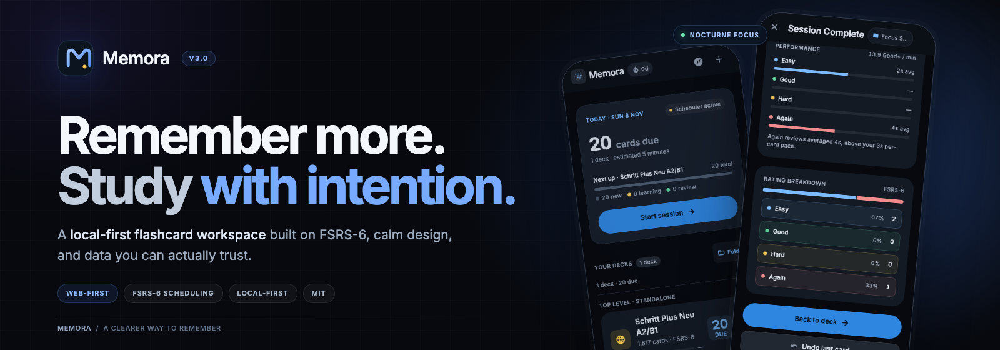
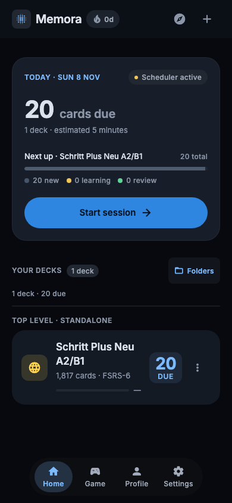
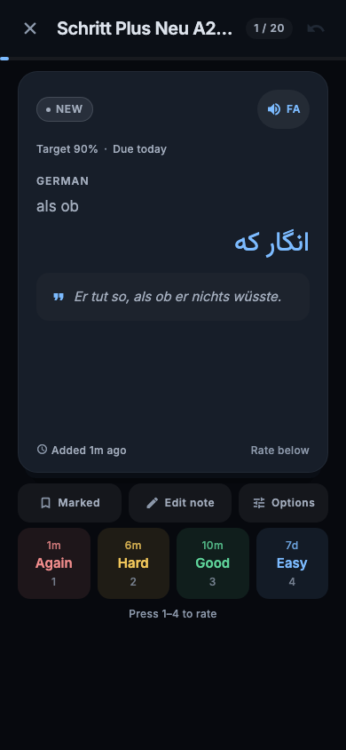
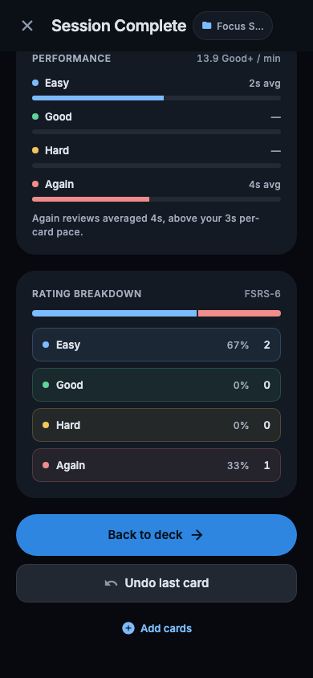
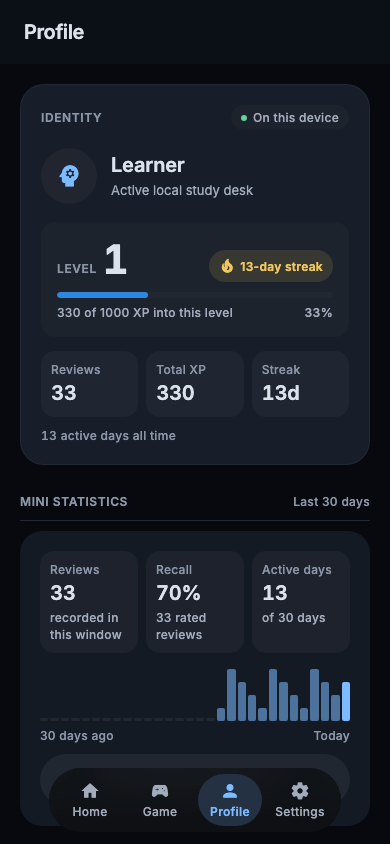
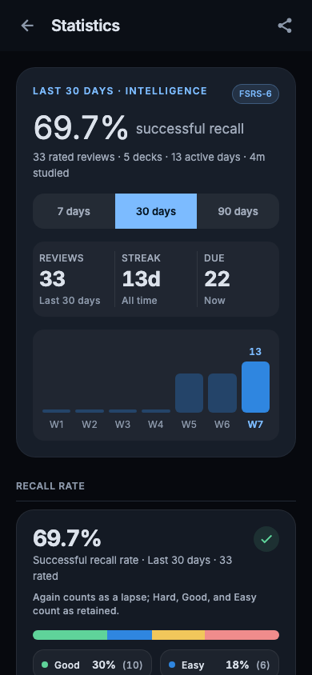
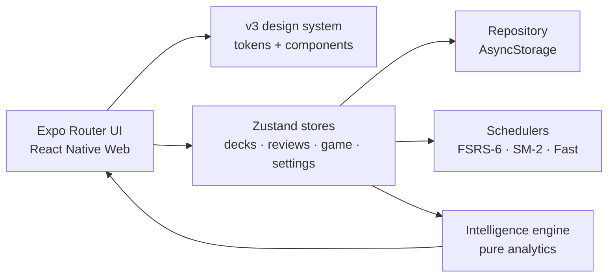

<div align="center">
  
</div>

<h1 align="center">Memora</h1>

<p align="center">
  <strong>Remember more. Study with intention.</strong><br />
  A local-first flashcard workspace for the web, built around FSRS-6 and data you can actually trust.
</p>

<p align="center">
  <a href="CHANGELOG.md">Changelog</a>
  &nbsp;·&nbsp;
  <a href="docs/design-language.md">Design language</a>
  &nbsp;·&nbsp;
  <a href="docs/test-report-2026-11-08-ui-v3.md">Verification report</a>
</p>

<p align="center">
  
  
  
  
  
  
</p>

---

**Memora** is a browser-first flashcard app for deliberate study. It combines a local library, FSRS-6 scheduling, a calm four-tab workspace, and an analytics layer that reports only what the review log can prove.

There is no account, no cloud sync, and no telemetry. Your decks, review history, settings, and game records stay in `AsyncStorage` on the device.

> **Current release: `3.0.0` — “Nocturne Focus.”**<br />
> Web only, by design. See [CHANGELOG.md](CHANGELOG.md) for the measured v3 release notes.

## Contents

- [Why Memora](#why-memora)
- [Product tour](#product-tour)
- [What is inside](#what-is-inside)
- [Study engine](#study-engine)
- [Game mode](#game-mode)
- [Learning intelligence](#learning-intelligence)
- [Design system](#design-system)
- [Architecture](#architecture)
- [Run locally](#run-locally)
- [Verification](#verification)
- [Project structure](#project-structure)
- [Contributing](#contributing)
- [License](#license)

## Why Memora

Most flashcard apps are good at collecting cards. Memora is designed around the harder part: **making a daily review habit feel clear, calm, and honest.**

- **Truth over decoration.** Recall, streaks, XP, forecasts, and session performance are derived from the review log. If a signal cannot be measured, the UI says so instead of inventing a number.
- **Local-first by default.** A full library can live in one browser without an account, a subscription, or a network round-trip.
- **One visual system.** Every screen uses the same ink canvas, scene panes, fills, type scale, and 44px controls. There is one place for color and one way to build a surface.
- **Made for real sessions.** The progress denominator stays stable, the last review can be undone, archived decks cannot start a session, and an empty deck never pretends to be “All done.”
- **A quieter kind of gamification.** The 60-second Game writes real reviews into the same schedule. It does not create a parallel progress system.

## Product tour

<table>
  <tr>
    <td align="center"></td>
    <td align="center"></td>
    <td align="center"></td>
  </tr>
  <tr>
    <td align="center"><strong>Home</strong><br /><sub>Today, folders, and decks</sub></td>
    <td align="center"><strong>Study</strong><br /><sub>Answer, intervals, four ratings</sub></td>
    <td align="center"><strong>Session review</strong><br /><sub>Time, recall, and pace</sub></td>
  </tr>
</table>

<table>
  <tr>
    <td align="center"></td>
    <td align="center"></td>
  </tr>
  <tr>
    <td align="center"><strong>Profile</strong><br /><sub>Progression backed by the review log</sub></td>
    <td align="center"><strong>Statistics</strong><br /><sub>Recall and memory over 7, 30, or 90 days</sub></td>
  </tr>
</table>

<sub>Screens captured from the app at 390×844. Home and Study use the shipped deck; Profile and Statistics use the deterministic dev fixture; session performance comes from a separate two-card session with real timings.</sub>

## What is inside

| Area | What it does |
| --- | --- |
| **Home** | Builds the day’s study picture: due count, next deck, folder shelf, pinned decks, and archived rows. |
| **Study** | Runs a scheduled session with a stable denominator, keyboard shortcuts, interval previews, notes, marking, and undo. |
| **Game** | A 60-second, four-option quiz with combos, time bonuses, sound, haptics, and real FSRS reviews. |
| **Profile** | Turns the review log into level, XP, streak, active days, recent activity, and evidence-backed achievements. |
| **Statistics** | A Profile drill-down with recall, review volume, memory, habits, forecast, insights, and reports. |
| **Library** | Creates, edits, searches, filters, archives, and files decks without moving their cards or schedules. |
| **Folders** | Groups decks into a browsable tree. A folder is a label, not a container: deleting one never deletes a deck. |
| **Settings** | Scheduler parameters, text-to-speech, offline cache, install state, sound, and haptics. |
| **Discover** | A small starter-deck catalogue with previews and sample-card counts that match the import. |
| **Accessibility** | Keyboard paths, visible focus rings, headings, 44px targets, reduced motion, and 200% text zoom. |

### The shipped library

A fresh install starts with **1,817 German → Persian cards** from *Schritt Plus Neu A2/B1*, including examples and RTL-aware answer text. The `/dev` screen can seed a deterministic six-deck fixture with 47 cards and 33 reviews for testing edge shapes: nested folders, archived decks, long names, an empty deck, RTL content, and overdue cards.

## Study engine

The scheduler is separated from the UI and covered by domain tests.

```text
due cards + daily caps
        │
        ▼
  build study queue ──► reveal answer ──► rate 1–4 ──► log review
        │                                      │
        │                                      ├─ FSRS-6 (default)
        │                                      ├─ SM-2 (legacy decks)
        │                                      └─ Fast Repetition (drill)
        ▼
  session summary: reviews, recall, duration, XP, performance
```

### Scheduling

- **FSRS-6 is the default.** Parameters are resolved per deck, with Anki-compatible defaults, desired retention, maximum interval, fuzz, and short-term scheduling.
- **SM-2 remains available** for decks that were created with it.
- **Fast Repetition** is a no-schedule drill mode for quick practice.
- Each card exposes **Again / Hard / Good / Easy** with an interval preview before you commit.
- The review log records the rating, timestamp, elapsed time, whether the card was new, and the pre-review FSRS state needed for rollback.
- Daily new/review caps are applied when the queue is built. A session keeps the denominator it started with.
- Undo removes the last review and restores the card’s prior schedule when the log has enough information.

### Session performance

The Session Complete screen adds a factual performance readout:

- **Time by rating** — how much of the session went to Easy, Good, Hard, and Again, with the average time per card in each bucket.
- **Good+ / min** — `(Good + Easy) / session minutes`; a pace signal, not a score.
- **Again versus pace** — compares the average Again time with the session’s overall per-card pace.
- **Timing unavailable** when the review log has no usable durations. Nothing is estimated or filled with placeholder numbers.

### A session, step by step

1. The queue is built from due cards, the deck’s daily caps, and its scheduler.
2. <kbd>Space</kbd> or the **Show answer** action reveals the back.
3. <kbd>1</kbd>–<kbd>4</kbd> rates Again, Hard, Good, or Easy. The chosen interval is shown before the next card.
4. The scheduler updates the card; the review store appends the review and its timing.
5. The session ends with reviews, recall, duration, XP, rating breakdown, and the performance pane.
6. **Undo last card** reverses the most recent review and returns to the card.

## Game mode

The **Game** tab is a fast recall loop, not a separate learning history.

- 60-second rounds with four answer options per card.
- A correct answer adds **3 seconds**; a wrong answer costs **2 seconds** and reveals the correct option.
- Combos multiply up to **×5**; clearing the deck pays a one-time **+250** bonus.
- Best score, best combo, and plays are stored per deck.
- Every answer is written as a real review: **Good** for correct, **Again** for wrong. The schedule, streak, and statistics all move with it.
- Sound and haptics are opt-out in Settings.
- A deck needs at least four distinct answer texts to be playable; the screen explains when it is not.

## Learning intelligence

Memora’s analytics are a **derived view of the review log**, not a second database of invented facts.

### Statistics

- **7, 30, and 90-day ranges** that recompute from the same log.
- Success recall with an explicit rating-colour legend: Good, Easy, Hard, and Again.
- Review volume, active days, current streak, due count, and study duration.
- Memory stability, weekday and hour habits, a seven-day scheduled workload forecast, and evidence-backed insights.
- Reports for the selected range, including the data-quality notes behind the numbers.

### Profile

- **10 XP per review**, **1,000 XP per level**; level and progress are presentation, not stored state.
- Current streak, active days, recent activity, and a 30-day mini-statistics preview.
- Five achievements, each with its evidence. When the data cannot verify a condition — for example, quiz accuracy for **Speed Demon** — the badge stays locked and the UI explains why.
- Archived decks are excluded from the learning summary; orphaned reviews remain part of the totals so history is not silently rewritten.

### Data truth

- A card’s due date, state, and review history are the only scheduling source.
- The study denominator does not grow when a card is requeued.
- Empty and archived decks have distinct, honest states.
- Starter-deck counts describe the cards the import actually creates.
- A metric without a source is not displayed as if it were measured.

## Design system

The v3 language is called **Nocturne Focus**: one ink canvas, one accent, separation through fills and depth rather than outlines, and a single source of truth for every visual value.

- `theme/palette.js` owns the raw colors; `theme/tokens.ts` and `theme/v3.ts` expose them to React Native and SVG.
- `npm run check:design` fails on raw hex or `rgba()` outside `theme/` (83 files checked in the current tree).
- `Surface`, `AppText`, `ListRow`, `Button`, and the v3 family replace hand-built panels, text, and rows.
- 44px minimum targets, visible focus rings, reduced-motion fallbacks, and a responsive 320–1440 layout are part of the system, not a polish pass.
- The full design law lives in [docs/design-language.md](docs/design-language.md) (Persian). If the code and the document disagree, the code changes.

The 84-surface verification manifest is the accessibility and responsive denominator. The v3 audit recorded **0 axe violations across 84 targets**, **0 controls under 44px**, and **0 document overflow at 320px**. Every route must have a fixture and a gate set in `tests/ui/surfaces.ts`.

## Architecture



| Layer | Location | Responsibility |
| --- | --- | --- |
| Routes | `app/` | Expo Router screens and the four-tab shell. |
| UI | `components/` | Shared primitives and the v3 component family. |
| State | `store/` | Zustand stores for decks, reviews, game records, settings, and install state. |
| Domain | `data/` | Types, repository, queue building, schedulers, quiz rules, progression, profile summaries, and the intelligence engine. |
| Platform | `services/` | TTS, haptics, navigation, install handling, export, and direction helpers. |
| Design | `theme/`, `global.css` | Palette, tokens, spacing, type, motion, and the one Tailwind bridge. |
| Verification | `tests/`, `scripts/` | Unit tests, Playwright suites, route manifest, census, responsive, axe, and visual checks. |

Everything runs in the browser. `worker.mjs` is an optional static-asset host that answers deep links with the exported SPA document; it does not add a server-side application runtime.

## Run locally

### Requirements

- **Node.js 22.13+** (the app is built on Expo SDK 58).
- A modern browser. Chromium is the verified target.

### Install and start

```bash
npm ci
npm run web
```

Open <http://localhost:8081>. If that port is busy, Expo selects the next available port (commonly `8082`).

### Build the web export

```bash
npm run build:web
npm run serve:dist
```

`build:web` writes the static SPA to `dist/`. `serve:dist` serves it at <http://127.0.0.1:3107> with SPA fallback and `no-store` responses.

### Useful commands

```bash
npx tsc --noEmit          # TypeScript
npm test                  # domain unit tests (node:test)
npm run test:surfaces     # route/surface parity manifest
npm run test:fixtures     # deterministic browser fixtures
npm run check:design      # raw-colour guard
npm run test:e2e          # Playwright; starts a dev server unless BASE_URL is set
npm run build:web         # production web export
```

To run Playwright against an already-running server:

```bash
BASE_URL=http://127.0.0.1:8082 npm run test:e2e
```

## Verification

The current tree was verified on **2026-11-08** against the running Chromium preview and the production web export.

| Gate | Command | Result |
| --- | --- | --- |
| Types | `npx tsc --noEmit` | **0 errors** |
| Domain tests | `npm test` | **183 / 183** |
| Surface parity | `npm run test:surfaces` | **11 / 11** |
| Surface manifest | `tests/ui/surfaces.ts` | **84 surfaces** |
| Design tokens | `npm run check:design` | **clean, 83 files** |
| Browser suite | `npm run test:e2e` | **123 / 123 passed** |
| Production export | `npm run build:web` | **dist/ exported** |

The v3 browser audit also measured 84 targets at eight widths from 320 to 1440, with 0 axe violations, 0 controls under 44px, 0 focus-ring misses, and 0 document overflow. Full evidence and scope notes are in [docs/test-report-2026-11-08-ui-v3.md](docs/test-report-2026-11-08-ui-v3.md).

**Coverage note:** Chromium is verified here. Firefox and WebKit binaries were unavailable in the verification workspace, so they are not claimed as passing.

### Local data and scope

- Data lives under the app’s `memory:*` AsyncStorage keys. Clearing site data removes the library, review history, settings, and game records.
- There is no cloud account, sync service, or server-side profile.
- The target is the web only; `app.json` sets `platforms: ["web"]` and there is no native project.
- The app is intentionally dark-only. No light theme is hidden behind a setting.

## Project structure

```text
app/                    Expo Router routes and the four-tab shell
components/v3/          Nocturne Focus component family
components/             Shared primitives: Screen, Surface, AppText, menus…
data/intelligence/      Pure analytics: series, memory, habits, forecast, insights
data/schedulers/        FSRS-6, SM-2, and Fast Repetition adapters
store/                  Zustand stores and persistence orchestration
services/               Platform adapters for TTS, haptics, install, export
theme/                   Palette, tokens, spacing, type, motion
tests/ui/               Surface manifest and fixture contract
tests/e2e/              Playwright flows, accessibility, visual, and boot checks
scripts/                Census, responsive, audit, and export helpers
docs/                   Design law, research, verification reports, and plans
```

### More documentation

- [Design language](docs/design-language.md) — the v3 rules for surfaces, type, spacing, color, motion, and components.
- [Verification report](docs/test-report-2026-11-08-ui-v3.md) — measured release evidence and known limitations.
- [Intelligence research](docs/intelligence/research.md) — the reasoning behind the analytics layer.
- [Changelog](CHANGELOG.md) — release-by-release changes, fixes, and measurements.

## Contributing

Small, focused contributions are welcome. A good pull request keeps the data contract honest and leaves the repository easier to verify than it found it.

Before opening a PR:

```bash
npm ci
npx tsc --noEmit
npm test
npm run check:design
npm run test:surfaces
npm run test:e2e
npm run build:web
```

A few project rules:

- **No raw visual values.** Colors come from `theme/`; spacing and sizes come from tokens. `npm run check:design` is a gate, not a suggestion.
- **No invented metrics.** If a number is not derived from `ReviewLogEntry`, it does not belong on a learning surface.
- **Keep the review log authoritative.** XP, streaks, recall, forecasts, and achievements are derived views.
- **New route, new surface.** Add the route to `tests/ui/surfaces.ts` with its fixture and gates.
- **Explain visual diffs.** Regenerate a screenshot baseline only when the rendered change is intentional; say why in the PR.
- **Do not add a dependency for a problem the existing stack can solve.** The project deliberately stays small.

For UI changes, include a before/after screenshot at 390px and 1280px. For data or scheduling changes, include the exact failing case and the test that now covers it.

## License

Released under the [MIT License](LICENSE).

---

<p align="center">
  <sub>Built for the web. Designed around what the data can prove.</sub>
</p>
