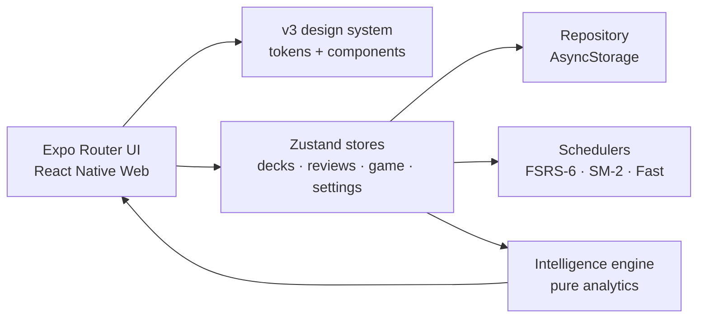

<h1 align="center">Memora</h1>

<p align="center">
  <strong>Remember more. Study with intention.</strong>
  <br />A local-first flashcard app for focused study, reliable scheduling, and meaningful progress.
</p>

<p align="center">
  <a href="https://site-4cf1794985694a0fbdbfb3b24dec3e09.freebuff.page"><strong>Open web app</strong></a>
  &nbsp;·&nbsp; <a href="#product-tour">Product tour</a>
  &nbsp;·&nbsp; <a href="#run-locally">Quick start</a>
  &nbsp;·&nbsp; <a href="#architecture">Architecture</a>
  &nbsp;·&nbsp; <a href="CONTRIBUTING.md">Contribute</a>
</p>

> **Privacy-first by design.** No account or cloud sync is required. Decks, review history, rest days, settings, and game records live in browser storage. Export a backup before clearing site data or switching browsers.

Memora combines **FSRS-6 spaced repetition**, organized decks and folders, a 60-second recall game, and learning statistics derived from real reviews. Navigate through **Home · Game · Profile · Settings**.

### Quick start

```bash
npm ci
npm run web
```

Requires **Node.js 22.13+**. See [Run locally](#run-locally) for production builds, tests, and deployment commands.

---

## Contents

- [Why Memora](#why-memora)
- [Recent improvements](#recent-improvements)
- [Product tour](#product-tour)
- [What is inside](#what-is-inside)
- [Study engine](#study-engine)
- [Game mode](#game-mode)
- [Learning intelligence](#learning-intelligence)
- [Design system](#design-system)
- [Architecture](#architecture)
- [Run locally](#run-locally)
- [Verification](#verification)
- [Project structure](#project-structure)
- [Contributing](#contributing)
- [License](#license)

## Why Memora

Most flashcard apps are good at collecting cards. Memora is designed around the harder part: **making a daily review habit feel clear, calm, and honest.**

- **Truth over decoration.** Recall, streaks, XP, forecasts, and session performance are derived from the review log. If a signal cannot be measured, the UI says so instead of inventing a number.
- **Local-first by default.** A full library can live in one browser without an account, a subscription, or a network round-trip.
- **One visual system.** Every screen uses the same ink canvas, scene panes, fills, type scale, and 44px controls. There is one place for color and one way to build a surface.
- **Made for real sessions.** The progress denominator stays stable, the last review can be undone, archived decks cannot start a session, and an empty deck never pretends to be “All done.”
- **A quieter kind of gamification.** The 60-second Game writes real reviews into the same schedule. It does not create a parallel progress system.

## Recent improvements

After the **v3.0.0 Nocturne Focus** release, development on `main` has continued. Highlights from **18–20 November 2026**:

| Area | What changed |
| --- | --- |
| **Home** | A selectable Today plan, clearer deck states, a unified create menu, and refined motion. |
| **Your decks** | Persistent Due / Name / Recent / Manual sorting, pinned items, and touch reordering. |
| **Folder review** | Review cards from active decks in a folder in one session, while retaining each deck’s scheduler and daily limits. |
| **Safer library management** | Undo a deck or folder deletion for six seconds; removing a folder unfiles its decks. |
| **Responsive layouts** | Improved narrow-phone controls, mobile achievements, tablet content alignment, and larger-screen readability. |
| **Streak calendar** | Home’s flame opens a month calendar with one protected rest day per ISO week, shared consistently with Profile and Statistics. |

These are **post-release changes**, not a newly tagged release or a newly completed full test audit. See [CHANGELOG.md](CHANGELOG.md) and the [contribution guide](CONTRIBUTING.md).

## Product tour

Memora's key screens, explained without screenshots:

| Screen | Experience |
| --- | --- |
| **Home** | Today's study plan, due cards, folders, and a searchable deck shelf with sorting and pinned items. |
| **Study** | Reveal answers, preview intervals, choose Again / Hard / Good / Easy, and review your session progress. |
| **Session review** | See session duration, recall, rating distribution, and review pace when recorded timing data is available. |
| **Profile** | View progress, streaks, level, and achievements derived from real reviews. |
| **Your Streak** | Browse study days, today, missed days, and protected rest days in a Monday-first calendar, with one rest day per week. |
| **Statistics** | Explore recall, activity, memory, habits, and reports over selected time ranges. |

## What is inside

| Area | What it does |
| --- | --- |
| **Home** | Organizes today's review plan and your folder/deck shelf, with persistent sorting, pinned items, and clear due states. |
| **Study** | Runs deck and combined-folder review sessions with a stable denominator, interval previews, keyboard shortcuts, and review undo. |
| **Game** | A 60-second, four-option quiz with combos, time bonuses, sound, haptics, and real FSRS reviews. |
| **Profile** | Turns the review log into level, XP, streak, active days, recent activity, and evidence-backed achievements. |
| **Your Streak** | A calendar view of real study days plus one weekly rest day that bridges continuity without adding activity. |
| **Statistics** | A Profile drill-down with recall, review volume, memory, habits, forecast, insights, and reports. |
| **Library** | Creates, edits, searches, sorts, filters, and archives decks, with a brief Undo window for deletion. |
| **Folders** | Groups decks in a flat shelf and can launch a combined review session. Deleting a folder unfiles its decks rather than deleting them. |
| **Settings** | Scheduler parameters, text-to-speech, offline cache, install state, sound, haptics, and local import/export. |
| **Discover** | A small starter-deck catalogue with previews and sample-card counts that match the import. |
| **Accessibility** | Keyboard paths, visible focus rings, headings, 44px targets, reduced motion, and 200% text zoom. |

### The shipped library

A fresh install starts with **1,817 German → Persian cards** from *Schritt Plus Neu A2/B1*, including examples and RTL-aware answer text. The `/dev` screen can seed a deterministic six-deck fixture with 47 cards and 33 reviews for testing edge shapes: a flat folder list, archived decks, long names, an empty deck, RTL content, and overdue cards.

## Study engine

The scheduler is separated from the UI and covered by domain tests.

```text
due cards + daily caps
        │
        ▼
  build study queue ──► reveal answer ──► rate 1–4 ──► log review
        │                                      │
        │                                      ├─ FSRS-6 (default)
        │                                      ├─ SM-2 (legacy decks)
        │                                      └─ Fast Repetition (drill)
        ▼
  session summary: reviews, recall, duration, XP, performance
```

### Scheduling

- **FSRS-6 is the default.** Parameters are resolved per deck, with Anki-compatible defaults, desired retention, maximum interval, fuzz, and short-term scheduling.
- **SM-2 remains available** for decks that were created with it.
- **Fast Repetition** is a no-schedule drill mode for quick practice.
- Each card exposes **Again / Hard / Good / Easy** with an interval preview before you commit.
- The review log records the rating, timestamp, elapsed time, whether the card was new, and the pre-review FSRS state needed for rollback.
- Daily new/review caps are applied when the queue is built. A session keeps the denominator it started with.
- Undo removes the last review and restores the card’s prior schedule when the log has enough information.

### Session performance

The Session Complete screen adds a factual performance readout:

- **Time by rating** — how much of the session went to Easy, Good, Hard, and Again, with the average time per card in each bucket.
- **Good+ / min** — `(Good + Easy) / session minutes`; a pace signal, not a score.
- **Again versus pace** — compares the average Again time with the session’s overall per-card pace.
- **Timing unavailable** when the review log has no usable durations. Nothing is estimated or filled with placeholder numbers.

### A session, step by step

1. The queue is built from due cards, the deck’s daily caps, and its scheduler.
2. <kbd>Space</kbd> or the **Show answer** action reveals the back.
3. <kbd>1</kbd>–<kbd>4</kbd> rates Again, Hard, Good, or Easy. The chosen interval is shown before the next card.
4. The scheduler updates the card; the review store appends the review and its timing.
5. The session ends with reviews, recall, duration, XP, rating breakdown, and the performance pane.
6. **Undo last card** reverses the most recent review and returns to the card.

## Game mode

The **Game** tab is a fast recall loop, not a separate learning history.

- 60-second rounds with four answer options per card.
- A correct answer adds **3 seconds**; a wrong answer costs **2 seconds** and reveals the correct option.
- Combos multiply up to **×5**; clearing the deck pays a one-time **+250** bonus.
- Best score, best combo, and plays are stored per deck.
- Every answer is written as a real review: **Good** for correct, **Again** for wrong. The schedule, streak, and statistics all move with it.
- Sound and haptics are opt-out in Settings.
- A deck needs at least four distinct answer texts to be playable; the screen explains when it is not.

## Learning intelligence

Memora’s analytics are a **derived view of the review log**, not a second database of invented facts.

### Statistics

- **7, 30, and 90-day ranges** that recompute from the same log.
- Success recall with an explicit rating-colour legend: Good, Easy, Hard, and Again.
- Review volume, active days, current streak, due count, and study duration.
- Memory stability, weekday and hour habits, a seven-day scheduled workload forecast, and evidence-backed insights.
- Reports for the selected range, including the data-quality notes behind the numbers.

### Profile

- **10 XP per review**, **1,000 XP per level**; level and progress are presentation, not stored state.
- Current streak, active days, recent activity, and a 30-day mini-statistics preview. One protected rest day per ISO week can bridge the streak without counting as a study day.
- Five achievements, each with its evidence. When the data cannot verify a condition — for example, quiz accuracy for **Speed Demon** — the badge stays locked and the UI explains why.
- Archived decks are excluded from the learning summary; orphaned reviews remain part of the totals so history is not silently rewritten.

### Data truth

- A card’s due date, state, and review history are the only scheduling source.
- The study denominator does not grow when a card is requeued.
- Empty and archived decks have distinct, honest states.
- Starter-deck counts describe the cards the import actually creates.
- A metric without a source is not displayed as if it were measured.

## Design system

The v3 language is called **Nocturne Focus**: one ink canvas, one accent, separation through fills and depth rather than outlines, and a single source of truth for every visual value.

- `theme/palette.js` owns the raw colors; `theme/tokens.ts` and `theme/v3.ts` expose them to React Native and SVG.
- `npm run check:design` checks for raw hex and `rgba()` outside `theme/`.
- `Surface`, `AppText`, `ListRow`, `Button`, and the v3 family replace hand-built panels, text, and rows.
- 44px minimum targets, visible focus rings, reduced-motion fallbacks, and a responsive 320–1440 layout are part of the system, not a polish pass.
- The full design law lives in [docs/design-language.md](docs/design-language.md) (Persian). If the code and the document disagree, the code changes.

The 84-surface verification manifest is the accessibility and responsive denominator. The v3 audit recorded **0 axe violations across 84 targets**, **0 controls under 44px**, and **0 document overflow at 320px**. Every route must have a fixture and a gate set in `tests/ui/surfaces.ts`.

## Architecture



| Layer | Location | Responsibility |
| --- | --- | --- |
| Routes | `app/` | Expo Router screens and the four-tab shell. |
| UI | `components/` | Shared primitives and the v3 component family. |
| State | `store/` | Zustand stores for decks, reviews, game records, settings, and install state. |
| Domain | `data/` | Types, repository, queue building, schedulers, quiz rules, progression, profile summaries, and the intelligence engine. |
| Platform | `services/` | TTS, haptics, navigation, install handling, export, and direction helpers. |
| Design | `theme/`, `global.css` | Palette, tokens, spacing, type, motion, and the one Tailwind bridge. |
| Verification | `tests/`, `scripts/` | Unit tests, Playwright suites, route manifest, census, responsive, axe, and visual checks. |

Everything runs in the browser. `worker.mjs` is the static-asset host used by the published build; it answers deep links with the exported SPA document and does not add a server-side application runtime.

## Run locally

### Requirements

- **Node.js 22.13+** (the app is built on Expo SDK 58).
- A modern browser. Chromium is the verified target.

### Install and start

```bash
npm ci
npm run web
```

Open <http://localhost:8081>. If that port is busy, Expo selects the next available port (commonly `8082`).

### Build the web export

```bash
npm run build:web
npm run serve:dist
```

`build:web` writes the static SPA to `dist/`. `serve:dist` serves it at <http://127.0.0.1:3107> with SPA fallback and `no-store` responses.

### Public build

The public build is the same static export, served by `worker.mjs` at
[memora](https://site-4cf1794985694a0fbdbfb3b24dec3e09.freebuff.page).

```bash
npm run build:web
npm run deploy:prepare
```

`deploy:prepare` writes `dist-deploy/`, the upload bundle. It removes the
`assets/node_modules` copies that Metro emits while keeping the static fonts,
icons and sound assets; the hosting validator does not accept dependency paths.
The worker answers extensionless HTML navigations with the SPA document, so a
deck or settings URL survives a refresh and a deep link.

### Useful commands

```bash
npx tsc --noEmit          # TypeScript
npm test                  # domain unit tests (node:test)
npm run test:surfaces     # route/surface parity manifest
npm run test:fixtures     # deterministic browser fixtures
npm run check:design      # raw-colour guard
npm run test:e2e          # Playwright; starts a dev server unless BASE_URL is set
npm run build:web         # production web export
```

To run Playwright against an already-running server:

```bash
BASE_URL=http://127.0.0.1:8082 npm run test:e2e
```

## Verification

The figures below describe the **2026-11-08 verification snapshot**, not the latest `main` commit. Subsequent changes have not been covered by a new full audit in this README; run the checks locally for current results.

| Gate | Command | Result |
| --- | --- | --- |
| Types | `npx tsc --noEmit` | **0 errors** |
| Domain tests | `npm test` | **190 / 190** |
| Surface parity | `npm run test:surfaces` | **11 / 11** |
| Surface manifest | `tests/ui/surfaces.ts` | **84 surfaces** |
| Design tokens | `npm run check:design` | **clean, 83 files** |
| Browser suite | `npm run test:e2e` | **123 / 123 passed** |
| Production export | `npm run build:web` | **dist/ exported** |

The **2026-11-08** v3 browser audit measured 84 targets at eight widths from 320 to 1440, with 0 axe violations, 0 controls under 44px, 0 focus-ring misses, and 0 document overflow. Full evidence and scope notes are in [docs/test-report-2026-11-08-ui-v3.md](docs/test-report-2026-11-08-ui-v3.md).

**Coverage note:** Chromium is verified here. Firefox and WebKit binaries were unavailable in the verification workspace, so they are not claimed as passing.

### Local data and scope

- Data lives under the app’s `memory:*` AsyncStorage keys. Clearing site data removes the library, review history, settings, and game records.
- There is no cloud account, sync service, or server-side profile.
- The target is the web only; `app.json` sets `platforms: ["web"]` and there is no native project.
- The app is intentionally dark-only. No light theme is hidden behind a setting.

## Project structure

```text
app/                    Expo Router routes and the four-tab shell
components/v3/          Nocturne Focus component family
components/             Shared primitives: Screen, Surface, AppText, menus…
data/intelligence/      Pure analytics: series, memory, habits, forecast, insights
data/schedulers/        FSRS-6, SM-2, and Fast Repetition adapters
store/                  Zustand stores and persistence orchestration
services/               Platform adapters for TTS, haptics, install, export
theme/                   Palette, tokens, spacing, type, motion
tests/ui/               Surface manifest and fixture contract
tests/e2e/              Playwright flows, accessibility, visual, and boot checks
scripts/                Census, responsive, audit, and export helpers
docs/                   Design law, research, verification reports, and plans
```

### More documentation

- [Design language](docs/design-language.md) — the v3 rules for surfaces, type, spacing, color, motion, and components.
- [Verification report](docs/test-report-2026-11-08-ui-v3.md) — measured release evidence and known limitations.
- [Intelligence research](docs/intelligence/research.md) — the reasoning behind the analytics layer.
- [Changelog](CHANGELOG.md) — release-by-release changes, fixes, and measurements.

## Contributing

Help keep Memora reliable, accessible, and easy to maintain. See [CONTRIBUTING.md](CONTRIBUTING.md) for the complete setup, conventions, validation commands, and pull request checklist.

UI contributions should include before/after screenshots at **390px** and a wider viewport. Scheduling and storage changes should include regression tests.
## License

See [LICENSE](LICENSE) for the repository license text. **Attribution note:** its current copyright line names Expo; the maintainer should review this before publishing new licensing statements.

---

<p align="center">
  <sub>Built for the web. Designed around what the data can prove.</sub>
</p>
