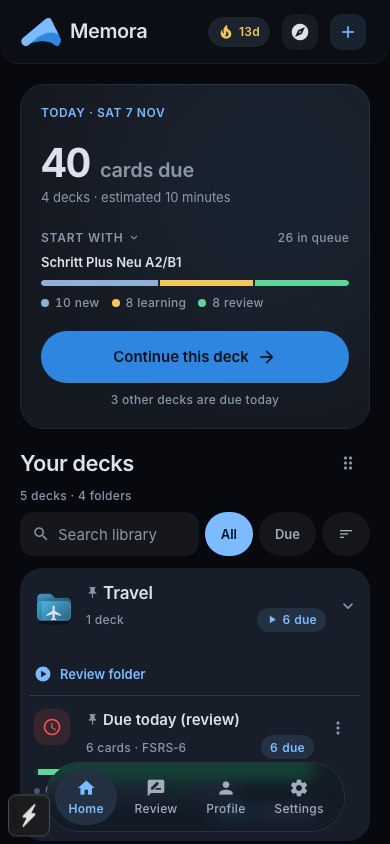
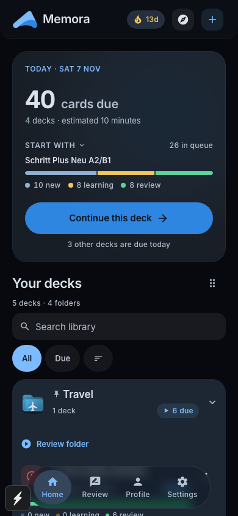
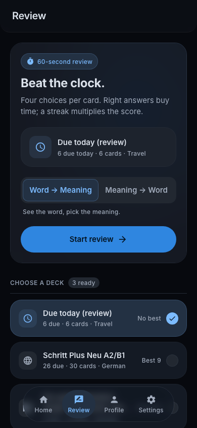
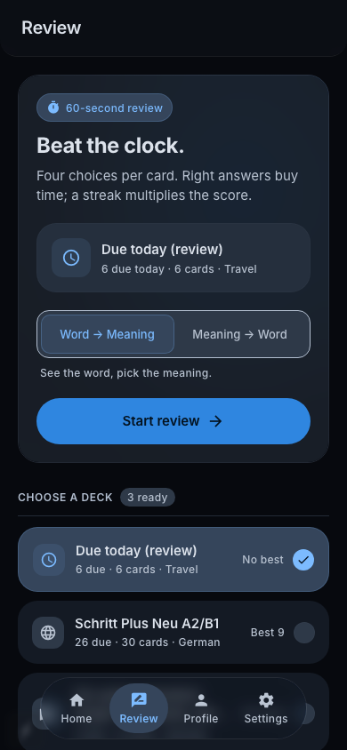
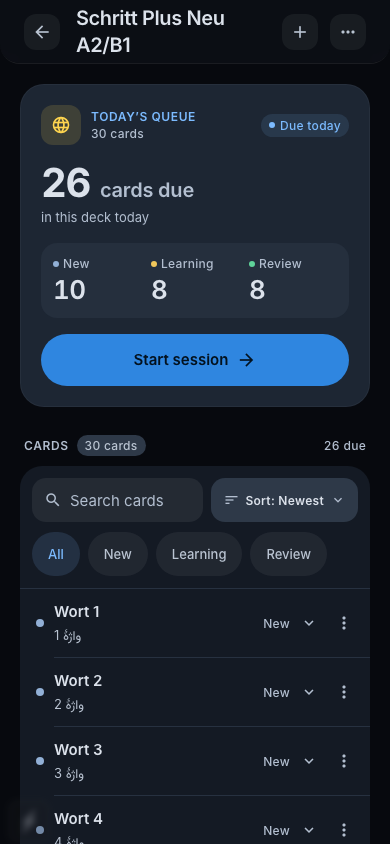
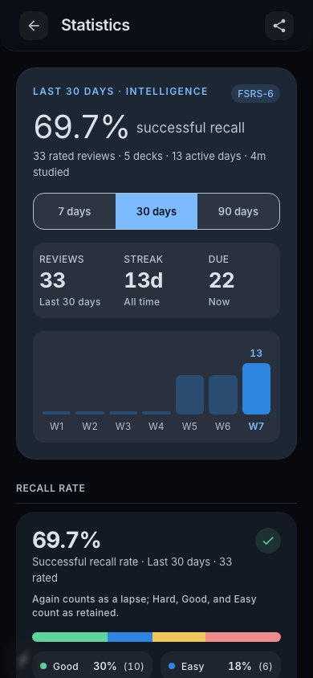

# Design drift repair — 21 November 2026

## Scope

Seven-phase repair of the design-language drift across the Expo SDK 58 web build:
guard, borders, primitives, tokens, surfaces/contrast, live responsive checks, and
the post-green screen-local split. The law remains `theme/` plus
`docs/design-language.md`; no new palette family or border vocabulary was
introduced.

## Baseline and result

| Check | Before | After |
| --- | --- | --- |
| `npm ci` | pass | pass (unchanged lockfile) |
| `npm run check:design` | **181 violations** | **0 violations / 107 files** |
| `npx tsc --noEmit` | pass | pass |
| `npm test` | 265 / 265 | 265 / 265 |
| `npm run test:e2e` | pre-pass baseline | **191 / 191** |

Baseline was captured at `7daa2a6` before any edit; the after tree is the
uncommitted design-fix work.

## Guard counts per rule

The extended guard was also run against the untouched `7daa2a6` tree with the
current allowlist, so these are real drift counts, not zero-by-construction:

| Rule | Before | After |
| --- | ---: | ---: |
| `border` — `borderWidth`/`borderColor`/rims outside §10 | 159 | 0 |
| `gutter-literal` — `paddingHorizontal: 20` in `app/` | 12 | 0 |
| `raw-animation` — `Animated.timing`/`spring` outside `motion/` | 8 | 0 |
| `raw-pressable` — app `<Pressable>` without name/44px target | 2 | 0 |
| **Total** | **181** | **0** |

Allowlisted §10 edges remain intentional: `SearchBar` focus, `RadioOptionCard`,
`Surface tone="scene"`, `SheetPanel`, the dashed empty frame, Review selection
chrome, quiz answer rims, and the floating header and tab-dock chrome rims.
`SearchBar` is fill-only with no resting edge; `Field`, the off `ToggleSwitch`
and `SegmentedControl` keep one existing-token edge.

## Surface ladder and contrast

The ten near-identical dark surfaces collapsed to five named roles. Ratios are
relative luminance against the previous role, measured with the WCAG formula:

| Role | Token | Value | Step |
| --- | --- | --- | ---: |
| Canvas | `colors.background` | `#07090E` | — |
| Pane | `glass.fill` | `#141A24` | 1.14× |
| Card face | `glass.cardFace` | `#1D2633` | 1.14× |
| Inset | `colors.surfaceInset` | `#252F3D` | 1.13× |
| Control | `colors.surfaceControl` | `#2E3948` | 1.16× |

`colors.selectionSurface` is a semantic selected state (`#35455B`), not a sixth
neutral role.

`outline` (`#B3BFD0`, tertiary text) contrast:

| Surface | Ratio |
| --- | ---: |
| Canvas | 10.70:1 |
| Pane | 9.38:1 |
| Card face | 8.19:1 |
| Inset | 7.26:1 |
| Control | 6.28:1 |
| Selection | 5.24:1 |

The active tab label uses accent `#7CBBFF` on `selectionSurface` and clears AA at
4.83:1. `SearchBar` is fill-only and its focus ring is the only edge. `Field`,
the off `ToggleSwitch` and `SegmentedControl` keep one 1px resting edge in the
existing `colors.outline` token; the edge is 9.38:1 against the pane. A
follow-up review removed only the search field’s outline because it read as
decoration rather than hierarchy.

Fill opacity now matches the documented scale:
`subtle 0.03 → inset 0.05 → tile 0.06 → control 0.075 → track 0.09`.

## Live layout pass

Seven routes × four widths = 28 checks, all passed:

| Width | Routes |
| --- | --- |
| 320px | Home, Library, Deck, Review, Statistics, Streak, Settings |
| 390px | same seven |
| 768px | same seven |
| 1280px | same seven |

Each check asserted no horizontal overflow (`scrollWidth - clientWidth <= 1`).
The pass also found and fixed:

- **Deck title:** `Schritt Plus Neu A2/B1` was ellipsized at 320 and 390. The
  page header now allows two lines; the name is complete at both widths.
- **Statistics labels:** `Median review time` and `Avg per active day` clipped at
  320. They now wrap to two lines, as does the per-deck name row.
- **Today header:** `TODAY · SAT 7 NOV` stays one line at 320; the streak chip is
  present in the hero and is a 45px target (44px can round to 43.99999).
- **Folders:** the folder header remains flat — no vertical nesting guide on
  children; the hint is the simple expand/collapse description.

## Screenshots

Same seeded F3 library, same 390×844 viewport, before from the untouched
`7daa2a6` worktree and after from the repaired tree.

### Home

| Before | After |
| --- | --- |
|  |  |

### Review

| Before | After |
| --- | --- |
|  |  |

### Deck and Statistics (after)

| Deck | Statistics |
| --- | --- |
|  |  |

Additional after capture: `assets/design-drift-after/home-320.png`.

## Phase 7 split

No behaviour changes; only file boundaries:

- `components/v3/StatsPrimitives.tsx` — `StatsSection`, `TinyPill`, `StatsCard`
  (moved from `app/statistics.tsx`).
- `components/v3/DeckChips.tsx` — `StatusChip`, `FilterPill` (moved from
  `app/deck/[id].tsx`).
- `components/v3/QuizTimerRing.tsx` — `TimerRing` (moved from
  `app/quiz/[deckId].tsx`).
- `app/study/[deckId].tsx` had no screen-local component left to move: its
  stage, waiting state, card and tray were already `components/v3/` components;
  only formatters remain local.

All three modules are re-exported from `components/v3/index.ts`.

## Final checks

- `npm run check:design` — clean, 107 files.
- `npx tsc --noEmit` — pass.
- `npm test` — 265/265.
- `npm run test:e2e` — 191/191 passed in 11.1 minutes, including `a11y.spec.ts`, `visual.spec.ts`, `statistics-visual.spec.ts` and all Phase 5 flows.

Visual baselines regenerated only for intentional changes: Review, Deck,
Profile at 320/390, the answered study card, and the 390px populated Statistics
sections. No layout-only pass rewrote unrelated baselines.

### Follow-up: search field outline removed

After the report pass, the resting outline on `SearchBar` was removed because it
read as decoration rather than hierarchy; the field now separates by fill and
keeps its focus ring. `Field`, the off `ToggleSwitch` and `SegmentedControl` keep
their existing-token edges. `SearchBar` is no longer in the guard allowlist, so a
new resting border on the search box fails `check:design`. The phone toolbar also
puts the full-width search above the All/Due/sort chips again. Re-checked after
these changes: `check:design` clean, `tsc` pass, 265/265 unit tests, 17/17 visual tests and 3/3 focused a11y cases. A final full `test:e2e` run after the settled toolbar and borders passed 191/191 in 11.1 minutes.

### Follow-up: chrome rims restored everywhere

The border sweep had also removed two chrome edges that the components still
documented: the floating header's single bottom rim and the tab dock's 1px rim.
Both are back at 1px `rims.soft`, with matching §10 and guard allowlist entries.
While verifying the dock, a latent drag race surfaced: re-measuring a tab whose
focused caption changed width could park the lens on the route tab mid-drag. The
layout-parking effect now yields while a drag owns the lens.

An all-route sweep checked all 25 routes at 390 and 768 (50/50): every screen
with an app bar reports the 1px header rim, all six tab routes report the dock
rim, and there were zero page errors or horizontal-overflow findings. `Add deck`
is a full sheet and correctly has neither chrome element. Visual baselines and
the report's after captures were refreshed for the restored chrome. A final full
`test:e2e` run passed 191/191 in 11.0 minutes.

One test-only measurement correction was needed: Chromium can report an exact
44px box as `43.999969` at a fractional y-position, so the folder-icon target
assertion now rounds to whole CSS pixels before checking the 44px minimum.

## Limits

- The live pass was Chromium at the four requested widths. Native iOS/Android
  rendering was not exercised.
- The contrast numbers are computed from the palette hex values; axe was also
  run over every a11y route and reported no violations.
- Screenshots are of the seeded F3 library, not production user data.
